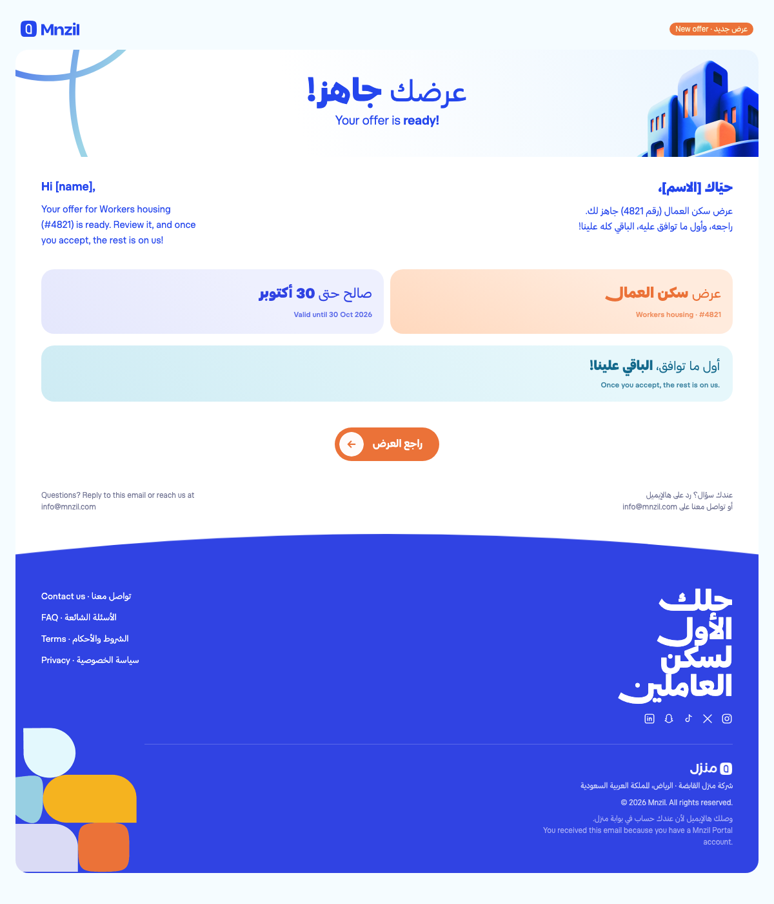
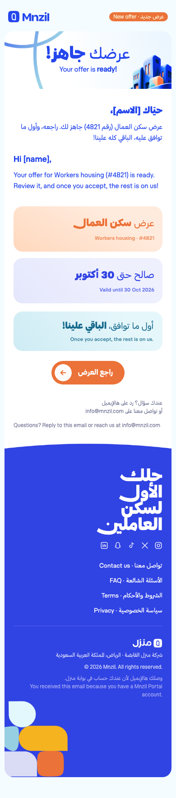

# Mnzil app emails

These are the Mnzil app emails, built from the Figma design so they work in a real inbox: images never break, the layout fills any screen width, and the footer shapes fall like they do on mnzil.com.

- **Live preview:** https://msnaila59-code.github.io/mnzil-emails/offer-ready/email.html
- **Email HTML (copy this into the sender):** [`offer-ready/email.html`](offer-ready/email.html)
- **Images:** [`offer-ready/images/v2/`](offer-ready/images/v2/), served from `https://msnaila59-code.github.io/mnzil-emails/offer-ready/images/v2/<file>` (`v1/` is the first test and stays frozen; the `t-*.png` files in `v2/` are from an earlier text-as-images test and are no longer used)

| Laptop | Phone |
|---|---|
|  |  |

## Why the images used to break, and the rules that stop it

1. **Never use Figma asset links.** `figma.com/api/mcp/asset/...` and Figma export links expire after 7–14 days, and then every image disappears. Every image here is a file in this repo, served by GitHub Pages at a permanent address.
2. **No SVG.** Gmail and Outlook block SVG images. Everything is PNG (2× for sharp screens) or GIF.
3. **No data: URIs and no local paths.** Gmail strips `data:image/...`. Every `src` is an absolute `https://` URL.
4. **Never edit a published image.** Files in `images/v1/` are frozen because emails already sent point at them. To change an image, add a new folder (`images/v2/`) and point new emails there.

## How the layout stretches

- There is no fixed-width box. The outer tables are `width="100%"` with a 24px gutter (10px on phones), so the card fills a laptop or a phone.
- Two-column rows (Arabic | English, the two tiles, footer brand | links) are `dir="rtl"` tables with 50% cells. On a wide screen, Arabic sits on the right. Under 620px, a media query stacks them with Arabic first, matching the mobile frame.
- The hero art is two background layers: the building pinned bottom-right and the swirl pinned top-left, over the gradient. The headline stays centred over them at any width. If a client blocks backgrounds (old Outlook), you see the gradient colour and the text, never a broken image.
- Gradients have a solid `bgcolor` fallback. Text colours that were `rgba()` in Figma are pre-mixed to solid hex.
- **All text is real text** in HT Equilibra via `@font-face` (the same files mnzil.com uses), with the Figma sizes, weights, letter spacing and px line heights.
- **Swash («سواش»)** is on exactly where Figma has it, checked line by line against the Figma render: «حلك», «الأول», «العاملين», «العمال» and «العرض» on the button (`font-feature-settings:'swsh' 1`). «لسكن» has none.
- The font stack also names `'HT Equilibra A'`, the installed family name, so any computer that has the brand font installed shows it even in Gmail. That's why a build that names the font looks right in Gmail on the design team's own computers. Customers don't have the font installed, so Gmail shows them the system font.
- The brand font and its swash show in Apple Mail, iPhone/iPad Mail, Outlook for Mac and Samsung Mail. **Gmail never loads web fonts for any sender**, so there the text is in the system font with no swash. The only way to get the swash in Gmail is to make those words images, and that was decided against: the text stays real text. Don't fake it with kashida (ـ): that was tried and rejected.

## Fallback font: why Gmail still looks close to HT Equilibra

Gmail (and any client that can't load the brand font) moves down the `font-family` list and uses the first font the device actually has. **The order of that list decides whether the email looks like the brand or looks old.** This is the stack used here:

```css
font-family: 'Mnzil Equilibra', 'HT Equilibra A', -apple-system, BlinkMacSystemFont, 'SF Arabic', 'Segoe UI', 'Noto Sans Arabic', Tahoma, Arial, sans-serif;
```

| Position | Font | Who gets it |
|---|---|---|
| 1 | `'Mnzil Equilibra'` (`@font-face`, mnzil.com's files) | Apple Mail, iPhone/iPad Mail, Outlook for Mac, Samsung Mail. The exact brand font with swash. |
| 2 | `'HT Equilibra A'` | Any device with the brand font installed (the design team's Macs), even in Gmail. |
| 3 | `-apple-system`, `BlinkMacSystemFont`, `'SF Arabic'` | Gmail on iPhone and Mac: Apple's own SF Arabic + SF Pro. A modern, clean, low-contrast sans that sits very close to HT Equilibra. This is why the email still "looks like our font" in Gmail on an iPhone. |
| 4 | `'Segoe UI'` | Gmail on Windows: Microsoft's modern sans, with Arabic. |
| 5 | `'Noto Sans Arabic'` | Gmail on Android: Google's modern Arabic sans (Roboto for Latin). |
| 6 | `Tahoma`, `Arial` | Last resort only. |

**The common mistake:** a stack like `'HT Equilibra A', Tahoma, Arial, sans-serif`. iPhones don't have Tahoma, and Arial has no Arabic letters, so iOS falls back to an older calligraphic-style Arabic system font. The Arabic then looks old and heavy next to the design. Putting the system fonts (`-apple-system` …) **before** Tahoma/Arial fixes that on Apple devices, and `Segoe UI` / `Noto Sans Arabic` do the same on Windows and Android.

Also keep these, so the fallback keeps the design's rhythm:
- **Line heights in px** (from Figma), never `normal`. Spacing then stays identical whatever font is drawn.
- **Real weights** (`400`, `500`, `600`, `800`), so the system fonts pick their matching medium, semibold and heavy faces.
- **No swash in the fallback.** System fonts have no `swsh`, so «حلك / الأول / العاملين / العمال / العرض» show plain there. Only images can carry the swash into Gmail.

To check a change, open the email in the **Gmail app on an iPhone and on an Android phone**, not only on a computer that has the brand font installed. Those computers show the real font even in Gmail and hide the problem.

## Button arrow

`btn-arrow.gif` is the Figma arrow in a white circle. It nudges forward (left, because the email is RTL) and glides back, on a loop, like the arrows in Mnzil's other emails. Rebuild it with `python3 tools/arrow_gif.py <out_dir>`.

## Falling shapes (footer)

mnzil.com's footer uses a Framer «Falling Objects» component built on Matter.js 0.19, with gravity 1, bounciness 0.5, friction 0.3, a 200 ms spawn delay and a random tilt. Email can't run JavaScript, so `tools/shapes_gif.py` bakes that motion into `shapes.gif`:

- The five shapes are the exact paths from the Figma «Shapes» group, and each one lands where the design puts it, bottom row first.
- The loop starts at rest (so Outlook, which shows only the first frame, still shows the design), then the shapes drop out, fall back in and settle. The cycle is about 7 seconds, so anyone who scrolls to the footer sees them fall.
- The GIF (`shapes-tall.gif`) is the footer cell's background, pinned bottom-left. It's 1100px tall on laptops and 878px on phones, taller than the footer on every screen (about 520px on a laptop, 750–780px on a phone). The shapes drop in from the very top of the blue area and pile up in the corner, and the cell's rounded corner clips them. The palette is locked to the exact brand blue, so there's no seam against the cell colour.

Regenerate it with `python3 tools/shapes_gif.py <out_dir>` (needs Pillow). If the footer grows, raise `H1` so the GIF stays taller than the footer on phones.

## Data in this test copy

The test is filled with: name [الاسم] / [name], request «سكن العمال» / Workers housing, #4821, valid until 30 Oct 2026, and the button links to https://mnzil.com. Replace those with the app's variables when wiring it into the sender.
